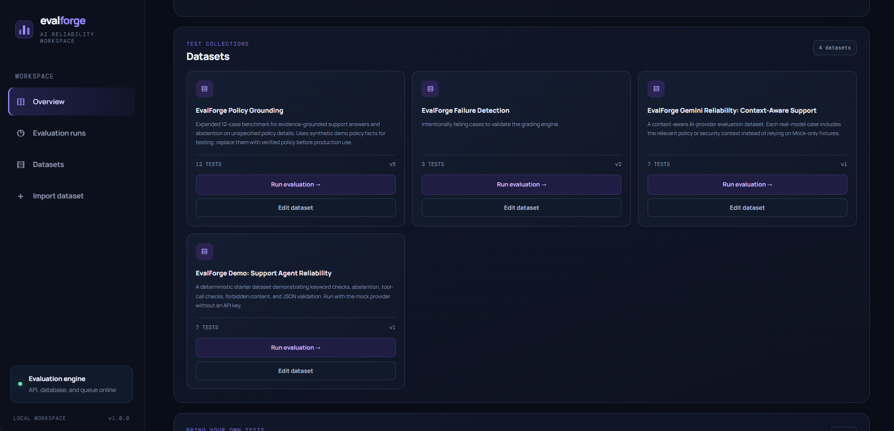
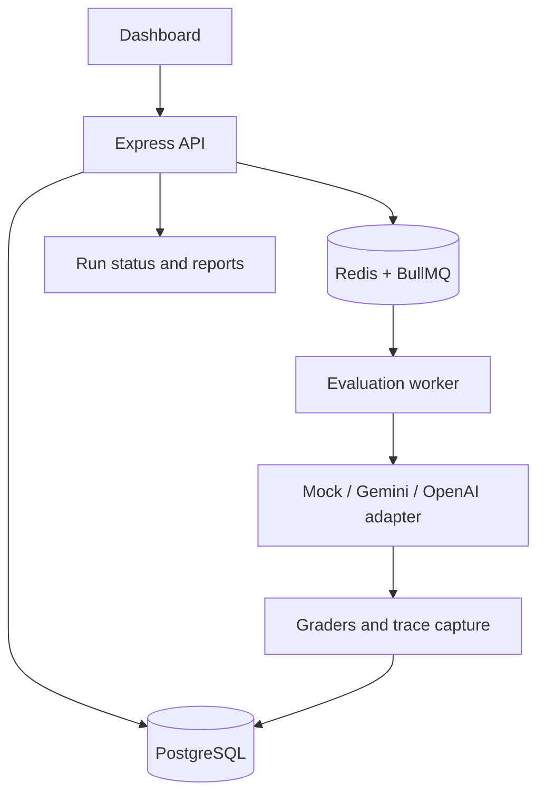

# EvalForge

[](https://github.com/Kerd3/EvalForge/actions/workflows/test.yml)

**An AI evaluation and reliability platform for testing model behavior, detecting regressions, and measuring run-to-run consistency.**

EvalForge is a backend-focused portfolio project built with **Node.js, Express, PostgreSQL, Redis, and BullMQ**. It runs test datasets against mock or live LLM providers, grades model responses, saves execution traces, compares evaluation runs, and reports observed model routing, latency, token usage, and configured cost estimates.

> **Project scope:** EvalForge is a portfolio MVP with production-oriented engineering foundations. It is not presented as a hardened, public, multi-tenant production service.

## At a glance

- **Providers:** deterministic Mock provider, Google Gemini, and OpenAI
- **Evaluation:** background jobs, configurable graders, per-case results, traces, and run comparison
- **Reliability:** repeated-run campaigns with per-case stability and run-to-run statistics
- **Observability:** requested vs. actual model IDs, fallback reasons, latency, token usage, and cost-estimate provenance
- **Datasets:** JSON import, editing, and immutable version history
- **Dashboard:** recent-run pagination, run inspection, dataset management, and reliability reporting

## Screenshots

### Dashboard and recent activity


### Dataset management



### Recent-run pagination and Run Inspector


### Model-level reporting and graded results


## Core capabilities

### Evaluation workflows

- Create JSON-based test datasets and save edits as new immutable versions.
- Queue evaluation runs through Redis and BullMQ rather than holding an HTTP request open until completion.
- Use the Mock provider for deterministic demonstrations without live-model calls.
- Run tests against Gemini or OpenAI and capture proposed tool/function calls without executing them.
- Compare two runs to identify pass-rate changes, per-case regressions, and improvements.
- Browse recent runs 10 at a time with numbered pagination.

### Grading

Rule-based graders include:

- Non-empty output
- Required and forbidden keywords
- Exact match and expected-output phrase checks
- Valid JSON
- Context-aware abstention checks
- Required and forbidden tool-call checks

An optional LLM-as-judge can apply an explicit rubric. Judge results are model-generated assessments and should be calibrated against labeled examples rather than treated as ground truth.

### Reliability campaigns

Run **2–10 sequential repetitions** against a pinned dataset version and configuration. The campaign report includes:

- Mean pass rate, run-to-run standard deviation, and observed range
- An exploratory 95% confidence interval for the mean run-level pass rate
- Per-case pass rate and pass/fail consistency
- Latency, cost coverage, and observed actual models
- A separate child run and inspectable results for each repetition

The confidence interval describes variability in the completed runs; it is not a guarantee of performance on unseen questions. Small datasets and fewer than five repetitions provide limited evidence.

### Model routing and cost observability

- Separate the requested model from the actual model that responded.
- Show mixed-model runs and per-case fallback reasons instead of mislabeling them as single-model benchmarks.
- Report provider errors where no model response was received.
- Estimate costs from configured input/output rates for the actual responding model, including fallback models.
- Explain when rates are missing, incomplete, provider-wide, or model-specific.

## Architecture



**Important design choices**

- Evaluation requests return a run or campaign identifier while work continues in the background.
- Dataset versions and stored evaluation results preserve what was tested at the time of a run.
- Per-case results are persisted, with duplicate-job protection and retry-aware processing.
- A `completed` run means processing finished; pass, fail, and error counts determine evaluation quality.
- Tool calls are captured for assessment, not executed, so evaluation cannot trigger tool side effects.

## Quick start with Docker

### Requirements

- Docker Desktop or Docker Engine
- Docker Compose plugin

### Start the app

```bash
git clone https://github.com/Kerd3/EvalForge.git
cd EvalForge
docker compose up --build -d
```

Open **http://localhost:3000**. The Compose setup starts PostgreSQL, Redis, the API, the background worker, and the migration/seed workflow. For a no-key demo, leave the provider set to **Mock provider** and use the seeded **EvalForge Demo: Support Agent Reliability** dataset.

The application requires an account. Copy `.env.example` to `.env` before startup (for example, `Copy-Item .env.example .env` in PowerShell). Registration is enabled by that local example for initial setup. If the database contains v1.0 datasets or runs, set a strong `EVALFORGE_BOOTSTRAP_SECRET`; the first account must provide it to claim those existing records. After creating the intended accounts, set `EVALFORGE_REGISTRATION_ENABLED=false` and restart. Cookies use `HttpOnly` and `SameSite=Lax`; `AUTH_COOKIE_SECURE` is false for local HTTP and must be true behind HTTPS. Compose publishes the API, PostgreSQL, and Redis on loopback only by default. Forwarded client IPs are ignored unless `TRUST_PROXY_HOPS` is set to the exact trusted proxy count; configure proxies to overwrite or safely append forwarded headers.

To follow logs:

```bash
docker compose logs -f api worker
```

To stop the services:

```bash
docker compose down
```

To also delete local database and Redis data:

```bash
docker compose down -v
```

**Warning:** `docker compose down -v` deletes the local EvalForge PostgreSQL and Redis volumes.

## Run a live-model evaluation

1. Create an API key with [Google AI Studio](https://aistudio.google.com/apikey) or your OpenAI account.
2. Copy `.env.example` to `.env` if needed, then set the appropriate key. In Windows PowerShell:

   ```powershell
   Copy-Item .env.example .env
   ```

   Keep API keys in `.env`. Do not put keys in browser code, commit them to Git, or share them in screenshots.
3. Restart the API and worker so they receive the environment changes:

   ```bash
   docker compose up --build -d
   ```

4. Select the provider and an available model in the dashboard, choose a dataset that includes relevant policy/context, and start the run.
5. Inspect each case and confirm the actual model, graders, execution trace, token counts, latency, and cost-estimate status.

Google applies model- and project-specific limits, and availability can change. EvalForge can fall back to configured Gemini models after supported availability, quota, or timeout failures. Fallback helps an evaluation continue, but the resulting run may contain more than one actual model. Use a strict single-model configuration when benchmarking one model, and verify the actual model recorded for every case before interpreting the score.

Use synthetic or non-sensitive content when testing with API tiers whose terms allow provider use of submitted content. Check the provider's current pricing, usage limits, and data terms before live evaluations.

## Cost configuration

Set exact per-model input and output rates in `.env` using `MODEL_COST_RATES_JSON`. Values are USD per **1,000,000 tokens**. Configure both rates for each model you expect to use, including fallback models. Cached input can have its own rate.

```dotenv
MODEL_COST_RATES_JSON='{"gemini":{"your-primary-model-id":{"inputPer1MUsd":1.0,"cachedInputPer1MUsd":0.25,"outputPer1MUsd":2.0,"pricingSource":"provider pricing page","effectiveDate":"YYYY-MM-DD","tier":"standard","assumptions":["USD list price"]},"your-fallback-model-id":{"inputPer1MUsd":0.5,"outputPer1MUsd":1.5}}}'
```

The rates above are illustrative placeholders, **not provider pricing**. Replace them with rates verified for your account, model, and pricing tier. Explicitly configuring both rates as `0` produces a zero estimate; only do this if zero is the assumption you intend to model. EvalForge cannot infer your billing tier from token counts.

Model-specific rates take priority. If no complete model-specific rate exists, complete provider-wide rates can be configured using `GEMINI_INPUT_COST_PER_1M_USD` and `GEMINI_OUTPUT_COST_PER_1M_USD` or the corresponding `OPENAI_...` variables. Add `*_CACHED_INPUT_COST_PER_1M_USD` only when a matching cached-input price is known. When a provider reports cached input but no cached rate is configured, EvalForge records a known subtotal and marks the full cost partial. Gemini tool-use prompt tokens are captured; because they may have distinct billing and this version has no separate tool-use rate, affected costs are partial. OpenAI reasoning-token counts are recorded as details of output tokens and are not added a second time. Pricing source, effective date, tier, assumptions, provider service tier, and capture time are saved with each call when available. Missing rates or unsupported billable categories remain unavailable/partial rather than being guessed. Historical snapshots are not recalculated after `.env` changes.

## Development and tests

Requirements for running outside Docker: **Node.js 20+**, PostgreSQL, and Redis.

```bash
npm install
npm run db:migrate
npm run db:seed
```

Use separate terminals:

```bash
npm run dev
npm run worker
```

Run the automated suites:

```bash
npm test
npm run test:regression
```

The regression workflow uses deterministic fixtures and does not need live Gemini/OpenAI credentials. GitHub Actions runs the test and regression commands on pushes and pull requests.

### Validation snapshot

During project validation, the following results were observed:

| Check | Result |
|---|---|
| Local automated suite | **91 tests passed across 13 files** |
| Dedicated regression suite | **7 tests passed across 2 files** (included in the full suite) |
| Live Policy Grounding evaluation | **12/12 passed** with `gemini-3.1-flash-lite` in a single-model run |
| Policy Grounding reliability campaign | **3 of 3 repeats at 100%**, with zero run-to-run standard deviation on this 12-case dataset |
| GitHub Actions | Successful for the pushed project changes, as verified during development |

These are project validation results, not a universal guarantee of model correctness. Policy Grounding uses a synthetic demonstration policy; its cases and graders should be reviewed before adapting it to a real organization's rules. Three repetitions are an encouraging smoke test, not a large statistical sample.

## Dataset format

Import JSON through the dashboard. A minimal test case looks like this:

```json
{
  "name": "Support agent smoke tests",
  "description": "A small regression suite",
  "test_cases": [
    {
      "name": "Mentions the return window",
      "input": {
        "context": "Eligible items may be returned within 30 days of delivery.",
        "message": "What is the return window?",
        "mock_response": {
          "content": "Eligible items may be returned within 30 days of delivery."
        }
      },
      "required_keywords": ["30 days"],
      "forbidden_keywords": ["guaranteed refund"],
      "grading_rules": {
        "exactMatch": false
      }
    }
  ]
}
```

`mock_response` is read only by the Mock provider; it is not sent to Gemini or OpenAI. For live-model evaluation, place the policy facts needed to answer correctly in `input.context`. Keyword rules are case-insensitive substring checks, so calibrate them to accept semantically equivalent phrasing where appropriate.

## HTTP API overview

All successful responses use a `{ "data": ... }` envelope. Errors use an `{ "error": { "message": ..., "details": ... } }` envelope.

| Method | Endpoint | Purpose |
|---|---|---|
| `POST` | `/api/auth/register` | Create an account (when registration is enabled); returns an HttpOnly session cookie |
| `POST` | `/api/auth/login` | Sign in and set an HttpOnly session cookie |
| `POST` | `/api/auth/logout` | Revoke the server-side session and expire the cookie |
| `GET` | `/api/auth/me` | Return the current account and account-setup state |
| `GET` | `/api/health` | API, database, and queue health |
| `GET` | `/api/datasets` | List datasets and latest version metadata |
| `POST` | `/api/datasets` | Create a dataset and its first version |
| `GET` | `/api/datasets/:id` | Get dataset metadata, versions, and latest cases |
| `PUT` | `/api/datasets/:id` | Save edits as a new immutable version |
| `GET` | `/api/evaluations?limit=50` | List recent runs (limit 1–100) |
| `POST` | `/api/evaluations` | Queue an evaluation; returns HTTP 202 |
| `GET` | `/api/evaluations/:id` | Get run summary, grader results, traces, and model report |
| `POST` | `/api/evaluations/:id/cancel` | Cancel a run between case executions |
| `POST` | `/api/evaluations/compare` | Compare two runs for pass-rate changes and per-case outcomes |
| `POST` | `/api/evaluation-campaigns` | Queue a repeated-run campaign; returns HTTP 202 |
| `GET` | `/api/evaluation-campaigns/:id` | Get campaign status, child runs, and reliability summary |
| `POST` | `/api/evaluation-campaigns/:id/cancel` | Cancel a queued or running campaign |

## Current MVP boundaries

- Accounts and server-side sessions protect dataset, run, and campaign routes. Existing database records remain unowned after migration until the first account claims them with the configured bootstrap secret. This app has not had an independent production penetration test; keep the self-hosted instance behind HTTPS and restrict network access.
- Gemini/OpenAI model IDs, availability, limits, and prices may change; check provider documentation and your own account settings.
- Live-model outputs can vary. Keyword and abstention graders need representative cases and careful calibration.
- Fallback can produce mixed-model runs. Check actual model IDs before comparing quality across runs.
- Cancellation is observed between cases; it does not necessarily interrupt an in-flight model request.
- Cases inside an individual run are processed sequentially. Reliability campaigns execute repetitions sequentially.
- The optional LLM judge is fallible and should not be treated as ground truth.

## Suggested future work

- Authentication, authorization, and run ownership before public deployment
- More extensive golden datasets and grader calibration against labeled examples
- Agent/retrieval intermediate-trace evaluation
- Paired statistical tests for baseline-versus-candidate comparisons
- Operational monitoring and deployment hardening for a public service

---

**EvalForge** — AI evaluation is a measurement practice, not a guarantee of correctness.


## Evaluation quality (Phase 2)

EvalForge supports labeled, versioned grader-calibration examples, explicit semantic equivalents for exact-match grading, paired baseline/candidate comparison with uncertainty estimates, and distinct provider/evaluator/model failure reporting. See [Evaluation Quality](docs/EVALUATION-QUALITY.md) and the importable [golden calibration dataset](examples/golden-grading-dataset.v1.json). After updating an existing database, run `npm run db:migrate`; then run `npm test` and `npm run test:regression`.
